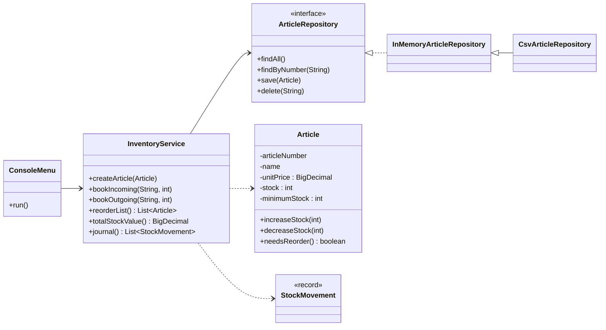

# Lagerverwaltung (Java)


Eine kleine Lagerverwaltung als Konsolenanwendung, also der Kern dessen, was ein ERP-System im Bereich Logistik leistet:
Artikel anlegen, Wareneingang und Warenausgang buchen, Nachbestellliste und Lagerwert auswerten.

Lernprojekt aus meiner Umschulung zur **Fachinformatikerin für Anwendungsentwicklung** (CBW Hamburg).
Schwerpunkte: saubere Objektorientierung, Schichtenarchitektur und automatisierte Tests.

## Funktionen

| Funktion | Beschreibung |
|---|---|
| Artikel anlegen | Mit Prüfung: Artikelnummer im Format `A-0000`, keine negativen Preise oder Bestände, keine Duplikate |
| Wareneingang / Warenausgang | Bestandsbuchung. Ein Warenausgang über den Bestand hinaus wird abgelehnt (`InsufficientStockException`) |
| Nachbestellliste | Alle Artikel mit Bestand ≤ Mindestbestand, nach Dringlichkeit sortiert |
| Lagerwert | Summe aus Bestand × Stückpreis, mit `BigDecimal` exakt berechnet |
| Buchungsjournal | Protokoll aller Bewegungen mit Zeitstempel |
| Persistenz | CSV-Datei mit `;` als Trennzeichen (öffnet sich direkt in Excel) |

## Architektur



**Drei Schichten:** Oberfläche (`ui`), Geschäftslogik (`service`) und Datenhaltung (`repository`).
Der Service hängt nur vom Interface `ArticleRepository` ab. Dadurch laufen die Tests mit einem In-Memory-Repository,
und die CSV-Datei ließe sich später durch eine Datenbank ersetzen, ohne die Geschäftslogik anzufassen.

### Bewusste Entscheidungen

- **`BigDecimal` für Preise:** `double` rechnet `0.1 * 3 = 0.30000000000000004`. Bei Geldbeträgen ist das nicht akzeptabel.
- **Kapselung des Bestands:** Der Bestand ändert sich nur über `increaseStock`/`decreaseStock`. Es gibt keinen Setter, deshalb kann er nie negativ werden.
- **`Clock` als Abhängigkeit:** Der Service bekommt die Uhr übergeben, damit Tests mit einem festen Zeitpunkt prüfen können.
- **Exceptions statt Fehlercodes:** Fachliche Fehler werden als Exception geworfen und in der Oberfläche verständlich angezeigt. Das Programm läuft danach weiter.

## Starten

Voraussetzung: **Java 21** oder neuer. Maven muss nicht installiert sein, der Maven Wrapper ist enthalten.

```bash
# Tests ausführen und bauen
./mvnw verify          # Windows: mvnw.cmd verify

# Anwendung starten (verwendet data/artikel.csv mit Beispieldaten)
java -jar target/lagerverwaltung-1.0.0.jar
```

> Unter Windows vorher `chcp 65001` ausführen, damit Umlaute und das €-Zeichen korrekt angezeigt werden.

## Tests

18 Unit-Tests mit **JUnit 5**, darunter parametrisierte Tests für die Eingabeprüfung und Tests mit temporären Dateien für die CSV-Persistenz.
Jeder Push läuft automatisch durch **GitHub Actions**.

```
ArticleTest .................. 10 Tests
InventoryServiceTest .........  6 Tests
CsvArticleRepositoryTest .....  2 Tests
```

## Ideen für die Weiterentwicklung

- Datenhaltung in einer relationalen Datenbank (JDBC), siehe mein Projekt [auftragsverwaltung-sql](../../../auftragsverwaltung-sql)
- Lagerplätze und Chargen
- REST-Schnittstelle bzw. Web-Oberfläche

---

**Ana Mercedes Murray Adames** · Hamburg · Umschulung Fachinformatikerin für Anwendungsentwicklung (12/2025 – 11/2027)
